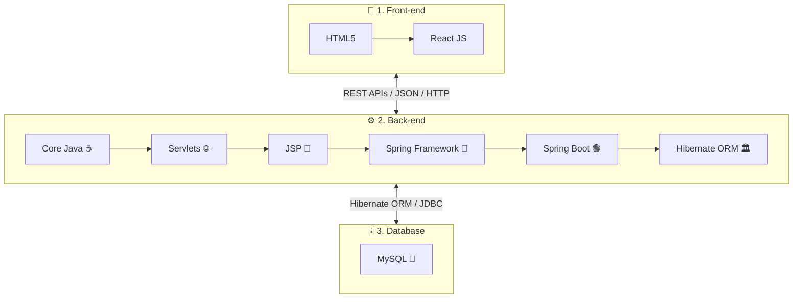

# <div align="center">🚀 Full Stack Java Developer Internship — The Kiran Academy</div>

<div align="center">

[](https://www.oracle.com/java/)
[](https://spring.io/projects/spring-boot)
[](https://hibernate.org/)
[](https://www.mysql.com/)
[](https://react.dev/)
[](https://developer.mozilla.org/en-US/docs/Web/HTML)

</div>

<div align="center">

[](#-internship-executive-profile)
[](https://www.thekiranacademy.com/)
[](#-the-official-3-pillar-roadmap)
[](#-internship-timeline--folder-structure)

</div>

---

## 📌 Executive Summary

Welcome to the central engineering repository for my **3-Month Full Stack Java Developer Internship** at **The Kiran Academy**, Pune. 

This repository documents the day-by-day practical implementations, architectural design patterns, database modeling, and full-stack software development covered across the comprehensive **Java Full Stack Roadmap**. The training is split into three foundational pillars: **Back-end Engineering**, **Database Management**, and **Modern Front-end Development**, culminating in end-to-end production-ready web applications.

---

## 🧭 The Official 3-Pillar Roadmap

Based on the official curriculum of **The Kiran Academy**, this internship is structured around three core architectural layers:



| Layer | Technologies Covered | Role in Full Stack Architecture |
|:---|:---|:---|
| **1. Front-end** | **HTML5**, **React JS** | Client-side user interface, state management, component lifecycle, REST API consumption |
| **2. Back-end** | **Core Java**, **Servlets**, **JSP**, **Spring**, **Spring Boot**, **Hibernate** | Business logic, request/response lifecycle, MVC design pattern, dependency injection, microservices, ORM mapping |
| **3. Database** | **MySQL** | Relational schema design, normalization, ACID transactions, complex queries, JDBC/JPA persistence |

---

## 📋 Table of Contents

- [Executive Summary](#-executive-summary)
- [The Official 3-Pillar Roadmap](#-the-official-3-pillar-roadmap)
- [Internship Executive Profile](#-internship-executive-profile)
- [Detailed Technical Curriculum & Syllabus](#-detailed-technical-curriculum--syllabus)
  - [Pillar 1: Back-end Engineering](#1-back-end-engineering)
  - [Pillar 2: Database Management](#2-database-management-mysql)
  - [Pillar 3: Front-end Engineering](#3-front-end-engineering)
- [Internship Timeline & Folder Structure](#-internship-timeline--folder-structure)
- [Day 01 Detailed Case Study](#-day-01-detailed-case-study)
- [Local Development & Execution Guide](#-local-development--execution-guide)
- [Engineering Standards & Best Practices](#-engineering-standards--best-practices)
- [Author & Acknowledgments](#-author--acknowledgments)

---

## 📌 Internship Executive Profile

| Field | Details |
|:---|:---|
| **Candidate / Intern** | **Kasim Shah** ([@kasimshah19](https://github.com/kasimshah19)) |
| **Role Title** | Full Stack Java Developer Intern |
| **Training Organization** | **The Kiran Academy**, Pune, Maharashtra |
| **Program Duration** | **3 Months** (October 2026 – December 2026) |
| **Core Architecture** | Multi-Tier Enterprise Web Application (React + Spring Boot + Hibernate + MySQL) |
| **Training Focus** | Practical daily task delivery, clean code, real-world full-stack capstone projects |

---

## 📚 Detailed Technical Curriculum & Syllabus

---

### 1. Back-end Engineering

The backend track forms the backbone of the internship, progressing from raw Java fundamentals to enterprise-grade Spring Boot microservices.

#### ☕ A. Core Java
- **Language Fundamentals:** JVM architecture, Bytecode execution, ClassLoader subsystem, Memory Allocation (Heap vs. Stack vs. Metaspace).
- **Data Types & Operators:** Primitives, Wrappers, Autoboxing/Unboxing, Arithmetic/Bitwise/Logical operators, Type Casting.
- **Control Flow & Logic Building:** Decision making (`if-else`, modern switch), Looping (`for`, `while`, `do-while`), Nested iterations, Number theory algorithms.
- **Object-Oriented Programming (OOP):**
  - **Encapsulation:** Access modifiers, Data hiding, POJOs, JavaBeans.
  - **Inheritance:** Single, Multilevel, Hierarchical; IS-A relationship; `super` keyword.
  - **Polymorphism:** Compile-time Overloading vs. Runtime Dynamic Method Dispatch; `@Override`.
  - **Abstraction:** Abstract classes vs. Pure Interfaces, default and static interface methods.
- **Strings & Memory Pool:** `String` immutability, String Constant Pool (SCP), `StringBuilder` and `StringBuffer` benchmarks.
- **Exception Architecture:** Checked vs. Unchecked exceptions, `try-catch-finally`, `throw`, `throws`, Custom application exceptions.
- **Java Collections Framework (JCF):** `List` (`ArrayList`, `LinkedList`), `Set` (`HashSet`, `TreeSet`), `Map` (`HashMap` internal hashing & rehashing mechanics, `TreeMap`), `Queue`.
- **Java 8+ Features:** Lambda Expressions, Functional Interfaces, Stream API (`filter`, `map`, `reduce`, `collect`), Optional class.
- **Multithreading & Concurrency:** Thread lifecycle, `Runnable`, Synchronization, Thread safety.

#### 🌐 B. Servlets
- Web Application Architecture, Client-Server model, HTTP Protocol (GET, POST, PUT, DELETE).
- Servlet Lifecycle (`init()`, `service()`, `destroy()`).
- Handling HTTP requests and responses using `HttpServletRequest` and `HttpServletResponse`.
- Session Management techniques: Cookies, `HttpSession`, URL Rewriting, Hidden Form Fields.
- Servlet Filters and Event Listeners.

#### 📑 C. JSP (JavaServer Pages)
- JSP Architecture and lifecycle phases (Translation, Compilation, Initialization, Execution).
- JSP Scripting elements: Scriptlets `<% %>`, Expressions `<%= %>`, Declarations `<%! %>`, Directives `<%@ %>`.
- JSP Action tags and standard tag libraries.
- JSTL (JSP Standard Tag Library) and EL (Expression Language) for clean separation of concerns.
- Classic Model-View-Controller (MVC Architecture) using Servlets as Controllers and JSP as Views.

#### 🍃 D. Spring Framework
- Core Architecture of the Spring Framework.
- Inversion of Control (IoC) Container: `BeanFactory` and `ApplicationContext`.
- Dependency Injection (DI): Constructor Injection vs. Setter Injection.
- Spring Bean Lifecycle, Bean Scopes (Singleton, Prototype, Request, Session).
- Aspect-Oriented Programming (AOP): Aspects, Advice, Pointcuts, Joinpoints.
- Spring MVC: `DispatcherServlet`, Controller mappings, Model, ViewResolvers.

#### 🟢 E. Spring Boot
- Fundamentals of Spring Boot: Opinionated Defaults, Auto-Configuration, Spring Boot Starters.
- Embedded Servers (Tomcat, Jetty, Undertow).
- Developing RESTful Web Services: `@RestController`, `@RequestMapping`, `@GetMapping`, `@PostMapping`, `@PutMapping`, `@DeleteMapping`.
- Request payload binding: `@RequestBody`, `@PathVariable`, `@RequestParam`, `@ResponseStatus`.
- Exception Handling: `@ControllerAdvice`, `@ExceptionHandler`, standard API response formatting.
- Spring Boot Actuator for application monitoring and metrics.

#### 🏛️ F. Hibernate ORM
- Object-Relational Mapping (ORM) principles and the impedance mismatch problem.
- Hibernate Architecture: `Configuration`, `SessionFactory`, `Session`, `Transaction`, `Query`.
- JPA (Java Persistence API) Annotations: `@Entity`, `@Table`, `@Id`, `@GeneratedValue`, `@Column`, `@Transient`.
- Entity Relationships: One-to-One (`@OneToOne`), One-to-Many (`@OneToMany`), Many-to-One (`@ManyToOne`), Many-to-Many (`@ManyToMany`).
- Cascading types (`CascadeType`) and Fetching strategies (`FetchType.LAZY` vs `FetchType.EAGER`).
- HQL (Hibernate Query Language) & Criteria API for dynamic queries.
- Integration: Spring Data JPA repositories (`JpaRepository`, `CrudRepository`) with automatic query derivation.

---

### 2. Database Management (MySQL)

A robust backend demands high-performance, well-structured relational storage.

- **Relational Concepts:** Tables, Columns, Rows, Primary Keys, Foreign Keys, Composite Keys, Unique Constraints.
- **SQL Sublanguages:**
  - **DDL (Data Definition Language):** `CREATE`, `ALTER`, `DROP`, `TRUNCATE`.
  - **DML (Data Manipulation Language):** `INSERT`, `UPDATE`, `DELETE`.
  - **DQL (Data Query Language):** Complex `SELECT` queries, `WHERE`, `ORDER BY`, `GROUP BY`, `HAVING`, Aggregate functions (`COUNT`, `SUM`, `AVG`, `MAX`, `MIN`).
  - **DCL & TCL:** `GRANT`, `REVOKE`, `COMMIT`, `ROLLBACK`, `SAVEPOINT`.
- **Relational Joins:** `INNER JOIN`, `LEFT JOIN`, `RIGHT JOIN`, `CROSS JOIN`, Self Joins.
- **Database Normalization:** 1NF, 2NF, 3NF, BCNF principles for eliminating data redundancy.
- **JDBC Integration:** Connecting Java applications to MySQL using MySQL Connector/J, executing `Statement` and parameterized `PreparedStatement` to prevent SQL Injection.

---

### 3. Front-end Engineering

Modern full-stack applications require responsive, dynamic, and intuitive user interfaces that communicate seamlessly with backend REST APIs.

#### 📄 A. HTML5
- Semantic HTML elements (`<header>`, `<nav>`, `<main>`, `<article>`, `<section>`, `<footer>`).
- Modern Form Controls, validations, inputs (`email`, `number`, `date`, `pattern`).
- Accessibility standards (ARIA attributes, semantic hierarchy).
- Tables, Lists, Media elements (``, `<video>`, `<audio>`).

#### ⚛️ B. React JS
- Core React Principles: Component-Driven Architecture, Virtual DOM reconciliation.
- JSX (JavaScript XML) syntax and embedding expressions.
- Functional Components vs. Class Components.
- Component State (`useState`) and Props management (unidirectional data flow).
- Component Side Effects & Lifecycle via `useEffect` hook.
- Event handling, conditional rendering, and rendering dynamic lists (`map()` with unique `key` props).
- Form handling: Controlled vs. Uncontrolled components.
- REST API Integration: Consuming Spring Boot endpoints using `fetch` API and `Axios`.
- Single Page Application (SPA) routing using React Router.

---

## 🗂️ Internship Timeline & Folder Structure

The repository is divided chronologically across the 3 calendar months, allowing incremental daily code tracking alongside modular topic packages:

```text
kiran-academy-java-internship/
│
├── 📁 October/                        # Month 1: Days 01 – 30 (30 Days)
│   │                                  # Focus: Core Java Fundamentals, OOP Logic & Computational Math
│   ├── 📁 Day01_Task1/                # Basic Syntax, Arithmetic Operators & Shopping Bill (Completed)
│   ├── 📁 Day02_Task2/                # Conditional Statements & Branching Logic
│   ├── 📁 Day03_Task3/                # Iterative Constructs & Loops
│   └── ... [Day04_Task4 to Day30_Task30]
│
├── 📁 November/                       # Month 2: Days 31 – 60 (30 Days)
│   │                                  # Focus: Advanced OOP, Exceptions, Collections, Servlets & JSP
│   ├── 📁 Day31_Task31/               # Class & Object Architectures
│   ├── 📁 Day32_Task32/               # Constructors & Polymorphic Design
│   └── ... [Day33_Task33 to Day60_Task60]
│
├── 📁 December/                       # Month 3: Days 61 – 90 (30 Days)
│   │                                  # Focus: Spring, Spring Boot, Hibernate ORM, MySQL & React JS
│   ├── 📁 Day61_Task61/               # Spring Boot REST API Construction
│   ├── 📁 Day62_Task62/               # Hibernate Entity Mapping & Persistence
│   └── ... [Day63_Task63 to Day90_Task90]
│
└── 📄 README.md                       # Comprehensive Internship Documentation & Syllabus Tracker
```

---

## 🌟 Day 01 Detailed Case Study

The journey kicked off on **Day 01** in [`October/Day01_Task1`](./October/Day01_Task1), establishing pristine coding standards, foundational Java arithmetic execution, and modular billing logic:

```
Variables tested:
- Arithmetic: a = 20, b = 3
- Shopping Bill: a = 100, b = 100, c = 100, d = 100, e = 100
```

| Source File | Technical Focus | Formula / Implementation | Verified Output |
|:---|:---|:---:|:---|
| [`Hello.java`](./October/Day01_Task1/Hello.java) | Standard output stream | `System.out.println("Hello World")` | `Hello World` |
| [`Addition.java`](./October/Day01_Task1/Addition.java) | Integer binary addition | `a + b` | `Addition of 20 and 3 = 23` |
| [`Difference.java`](./October/Day01_Task1/Difference.java) | Integer subtraction | `a - b` | `Difference of 20 and 3 = 17` |
| [`Multiplication.java`](./October/Day01_Task1/Multiplication.java) | Integer multiplication | `a * b` | `Multiplication of 20 and 3 = 60` |
| [`Division.java`](./October/Day01_Task1/Division.java) | Explicit double casting | `(double) a / b` | `Division of 20 and 3 = 6.666666666666667` |
| [`Modulus.java`](./October/Day01_Task1/Modulus.java) | Remainder / Modulo operator | `a % b` | `Modulus of 20 and 3 = 2` |
| [`ShoppingBill.java`](./October/Day01_Task1/ShoppingBill.java) | Methods & Multi-tier GST Billing | `GST (18%, 13%, 7%) - 20% Disc.` | `Total after GST = 569.00 \| Discount = 113.80 \| Final payable amount = 455.20` |

---

## 💻 Local Development & Execution Guide

### 1. Development Prerequisites
Ensure the following developer toolchains are installed:
- **JDK (Java Development Kit):** 8 or newer (JDK 17/21 recommended for Spring Boot)
- **MySQL Server & Workbench:** For relational database storage
- **Node.js & npm:** For the React JS frontend layer
- **IDE:** IntelliJ IDEA / Eclipse / VS Code

### 2. Verify Installations
```bash
java -version
javac -version
mysql --version
node -v
npm -v
```

### 3. Clone Repository
```bash
git clone https://github.com/kasimshah19/kiran-academy-java-internship.git
cd kiran-academy-java-internship
```

### 4. Running Java Tasks
```bash
# Example: Compiling and executing Day 01 Division Task
cd October/Day01_Task1
javac Division.java
java Division
```

---

## 🧼 Engineering Standards & Best Practices

All code committed across this 3-month internship adheres to enterprise software engineering standards:

1. **Clean Code & Naming Conventions:**
   - Classes use `PascalCase` (`EmployeeService`, `Division`).
   - Variables and Methods use `camelCase` (`calculateBonus()`, `employeeId`).
   - Database tables use `snake_case` (`employee_records`, `order_items`).
2. **Layered Separation of Concerns (MVC):**
   - **Controller Layer:** Handles HTTP requests and delegates to services.
   - **Service Layer:** Houses core business logic and transaction management.
   - **Repository / DAO Layer:** Handles database persistence using Spring Data JPA / Hibernate.
   - **UI Layer:** Pure React components handling presentation and state.
3. **Repository Cleanliness:**
   - Zero tracked compiler artifacts (`.class` files, `target/`, `node_modules/`).
   - Every program is self-contained, validated, and free of extraneous debug logs.

---

## 👤 Author & Acknowledgments

- **Intern / Developer:** **Kasim Shah**
  - **GitHub:** [@kasimshah19](https://github.com/kasimshah19)
  - **Repository:** [kiran-academy-java-internship](https://github.com/kasimshah19/kiran-academy-java-internship)
- **Training Institution:** [The Kiran Academy](https://www.thekiranacademy.com/), Pune, Maharashtra
- **Special Thanks:** Sincere gratitude to the faculties, mentors, and placement coordinators at The Kiran Academy for their comprehensive guidance, structured curriculum, and relentless focus on practical engineering excellence.

---

<div align="center">
  <b>⭐ Star this repository if you are following along with the Java Full Stack learning journey! ⭐</b><br>
  <i>Built with discipline, continuous learning, and clean code standards.</i>
</div>
